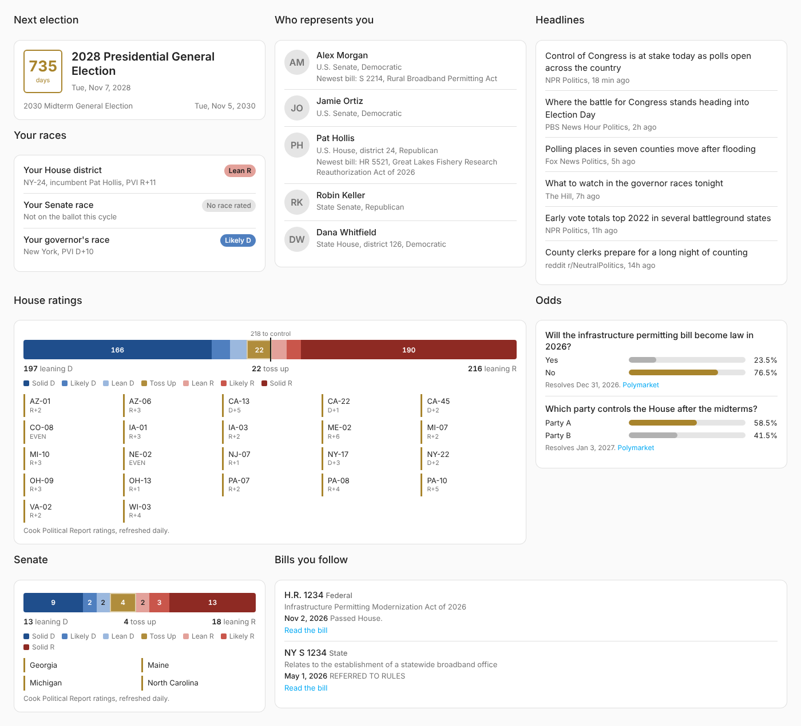

# Boiler Room

US politics for Home Assistant. Who represents your house and how they vote, who's raising the money in your races, what the White House just signed, where the bills you care about stand, what the forecasters and prediction markets think, the day's headlines, and when the next election is — as ordinary sensors, a calendar and automation events.

Boiler Room doesn't editorialize. It reads public data sources and shows you what they say.

## What you get

| Device | Entities | Needs |
|---|---|---|
| **Representatives** | Your two U.S. senators, U.S. representative, state senator and state representative/assembly member — name as the state, photo as the entity picture, party, district, email and links in attributes. With a Congress.gov key, each member of Congress also shows their newest sponsored bill. | Open States key (finds everyone from your home location). Congress.gov key alone works too if you pick your state and district. |
| **Legislation** | One sensor per followed bill. State = latest action; title, sponsor, dates and link in attributes. | Congress.gov key (federal), Open States key (state) |
| **Race Ratings** | Cook Political Report ratings for your House district, Senate race and governor's race (`Lean R`, `Toss Up`, …, with Cook PVI and incumbent), plus House/Senate/governor toss-up counts with the full rating breakdown and the list of toss-up races. | Your own Cook subscription with API access |
| | Optional, experimental: `Crystal Ball latest`, the newest Sabato's Crystal Ball (UVA Center for Politics) articles, with rating-change posts flagged. [See the caveat.](#sabatos-crystal-ball) | Nothing |
| **Floor Votes** | `Latest House vote` (result + bill, party breakdown, the last 10 roll calls in attributes), `Your representative's last vote` (Yea/Nay, and whether they voted with their party), and `Your representative's party-line votes` (% of recent contested votes cast with their party's majority, plus the ones where they broke ranks). | Congress.gov key |
| **Campaign Finance** | `Top fundraiser` for your House race, your Senate race, and the presidential race in presidential cycles. Every candidate's money raised, spent and cash on hand is in attributes, from FEC filings. | Nothing (a free api.data.gov key lifts the shared demo key's limits). Needs your home state, and your district for the House race. |
| **Executive Actions** | `Latest executive action` (executive orders, proclamations, memoranda, with number, signing date and link) and `Executive orders this year`. | Nothing |
| **Prediction Markets** | One sensor per Polymarket or Kalshi market or event. Yes/No markets report the implied probability in %; multi-candidate events report the leader with every outcome's odds in attributes. | Nothing |
| **News** | `Latest headline`, with the most recent headlines across your chosen outlets in attributes. `Latest politico post`, the newest posts from the analysts you follow on Bluesky (text, link preview, likes, link to the post). | Nothing |
| **Elections** | `Election day` (on today if there's an election), `Next election` (date + days until), and an `Elections` calendar. Federal general elections are always included; a Google Civic key adds official listings for your state. | Nothing (Google Civic key optional) |

### Automation events

| Event | Fired when | Data |
|---|---|---|
| `boiler_room_bill_action` | A followed bill gets a new latest action | `level`, `bill`, `title`, `action`, `date`, `url` |
| `boiler_room_odds_moved` | An outcome moves at least the threshold (default 5 points) between checks | `market`, `outcome`, `from`, `to`, `change`, `url`, `source` |
| `boiler_room_rating_changed` | Cook moves a race's rating | `chamber`, `race`, `state`, `district`, `from`, `to` |
| `boiler_room_new_headline` | A new headline shows up | `title`, `link`, `source`, `published` |
| `boiler_room_rep_vote` | Your U.S. representative votes on a new House roll call | `representative`, `vote`, `with_party`, `roll`, `question`, `bill`, `result`, `date`, `url` |
| `boiler_room_fundraising_report` | A candidate in one of your races files a new FEC report | `office`, `candidate`, `party`, `raised`, `raised_since_last`, `cash_on_hand`, `through`, `url` |
| `boiler_room_executive_action` | A new presidential document is published | `title`, `kind`, `number`, `signed`, `published`, `president`, `url`, `pdf_url` |
| `boiler_room_politico_post` | Someone you follow on Bluesky posts | `author`, `handle`, `text`, `created`, `url`, `link_title`, `link_url` |
| `boiler_room_crystal_ball_post` | A new Crystal Ball article appears (only when the feed is readable) | `title`, `link`, `published`, `rating_change` |

## Install

1. In HACS, open the menu → **Custom repositories**, add `https://github.com/jordanwalk193/ha-boiler-room` as an **Integration**.
2. Download **Boiler Room** and restart Home Assistant.
3. **Settings → Devices & services → Add integration → Boiler Room.**
4. Paste whichever keys you have (all optional, all free), then hit **Configure** to choose what to follow.

### Free API keys

| Key | Unlocks | Get one |
|---|---|---|
| Congress.gov | Federal bills, members' sponsored bills | [api.congress.gov/sign-up](https://api.congress.gov/sign-up/) — arrives by email in a minute |
| Open States | Auto-detects every legislator for your home location; state bills | [open.pluralpolicy.com](https://open.pluralpolicy.com/accounts/profile/) |
| Google Civic Information | Official election listings for your state | Enable the Civic Information API in [Google Cloud Console](https://console.cloud.google.com/apis/library/civicinfo.googleapis.com) and create an API key |
| FEC (api.data.gov) | Optional. Without it Boiler Room uses the shared `DEMO_KEY`, which covers a home's races twice a day. | [api.data.gov/signup](https://api.data.gov/signup/) |

### Cook Political Report

Cook offers an official ratings API for private, non-profit and academic use. It needs a Cook subscription plan that includes API access — see [cookpolitical.com/api](https://www.cookpolitical.com/api) and use **Request access** there if your plan doesn't have it yet. Boiler Room signs in with your own Cook email and password, pulls ratings once a day (Cook's request), and never shares them anywhere. It does not scrape cookpolitical.com.

If a Cook sensor looks off, download the integration's diagnostics: the `cook_fields` section lists the field names Cook returned, which makes parser fixes quick.

Keys can be changed later from the integration's **Reconfigure** menu.

## Configure

| Option | Example |
|---|---|
| Federal bills | `HR 1234`, `S.55`, `118/hr/815`, or a congress.gov bill link. Bare numbers mean the current Congress. |
| State bills | `S1234`, `A 5678` (your state), or `ca:AB12` for another state |
| Polymarket | Paste the polymarket.com link for a market or event, or just its slug |
| Kalshi | Paste the kalshi.com market link, or the event ticker (`KXNEXTSPEAKER-31`) |
| House floor votes | On by default when there's a Congress.gov key |
| Campaign finance | On by default |
| Executive actions | On by default |
| Sabato's Crystal Ball articles | Off by default; experimental, see below |
| News outlets | NPR, PBS News Hour, The Hill, Fox News (on by default), plus BBC US and Politico |
| Politicos | Bluesky handles or bsky.app profile links. Starts with the nonpartisan handicappers: the Cook Political Report, Erin Covey (Cook), Jacob Rubashkin (Inside Elections), Kyle Kondik and Larry Sabato (Crystal Ball) and the UVA Center for Politics. `none` turns it off. |
| Extra feeds | Any RSS/Atom URL — a local paper, a Substack, or a subreddit like `https://www.reddit.com/r/NeutralPolitics/.rss` |
| Headline keywords | `Syracuse, Hochul, budget` — keep only headlines that mention one of these |

## Dashboard



The integration ships its own dashboard. Go to **Settings → Dashboards → Add dashboard → New dashboard from scratch**, open it, choose **Edit → ⋮ → Raw configuration editor**, replace everything with:

```yaml
strategy:
  type: custom:boiler-room
```

and save. You get an **Overview** tab plus **Race ratings**, **Votes**, **Money**, **White House**, **Bills**, **Odds**, **News** and **Elections** tabs; tabs for sources you haven't set up are left out. On election day the countdown turns into a polls-open banner.

Each panel is also a card you can drop on any dashboard:

```yaml
type: custom:boiler-room-card
panel: ratings      # election, reps, home_races, ratings, votes, money, executive, crystal_ball, politicos, bills, odds, headlines
chamber: house      # ratings only: house, senate or governor
limit: 10           # ratings: toss-up races listed (0 hides the list); headlines/votes/executive/crystal_ball/politicos: how many
outcomes: 4         # odds: outcomes shown per multi-candidate market
title: Optional heading
```

The cards find Boiler Room's entities on their own, so renaming entity IDs doesn't break them. Colors follow your theme, light or dark.

## More examples

**Phone alert when a bill you follow moves**

```yaml
automation:
  - alias: Bill update
    trigger:
      - platform: event
        event_type: boiler_room_bill_action
    action:
      - service: notify.mobile_app_phone
        data:
          title: "{{ trigger.event.data.bill }}"
          message: "{{ trigger.event.data.action }}"
          data:
            url: "{{ trigger.event.data.url }}"
```

**Porch light reminder on election day**

```yaml
automation:
  - alias: Election day reminder
    trigger:
      - platform: time
        at: "07:00:00"
    condition:
      - condition: state
        entity_id: binary_sensor.boiler_room_elections_election_day
        state: "on"
    action:
      - service: tts.speak
        target:
          entity_id: tts.home_assistant_cloud
        data:
          media_player_entity_id: media_player.kitchen
          message: "Polls are open today."
```

**Headlines card**

```yaml
type: markdown
title: Headlines
content: >
  
  - [{{ h.title }}]({{ h.link }}) <small>{{ h.source }}</small>
  
```

**Tell me when my representative breaks with their party**

```yaml
automation:
  - alias: Rep broke ranks
    trigger:
      - platform: event
        event_type: boiler_room_rep_vote
        event_data:
          with_party: false
    action:
      - service: notify.mobile_app_phone
        data:
          title: "{{ trigger.event.data.representative }} broke ranks"
          message: "Voted {{ trigger.event.data.vote }} on {{ trigger.event.data.bill or trigger.event.data.question }} ({{ trigger.event.data.result }})"
```

**New executive order announcement**

```yaml
automation:
  - alias: New executive order
    trigger:
      - platform: event
        event_type: boiler_room_executive_action
        event_data:
          kind: Executive Order
    action:
      - service: notify.mobile_app_phone
        data:
          title: "Executive Order {{ trigger.event.data.number }}"
          message: "{{ trigger.event.data.title }}"
```

**Odds for a multi-candidate event**

```yaml
type: markdown
content: >
  
  **{{ state_attr(e, 'question') }}**
  
  - {{ name }}: {{ pct }}%
  
```

## How often it checks

| Source | Interval |
|---|---|
| Polymarket, Kalshi | 5 minutes |
| News, Bluesky politicos | 10 minutes |
| Federal bills | 30 minutes |
| State bills | 1 hour (Open States' free tier is small; requests are spaced 1 s apart) |
| Representatives | Daily |
| Elections | Every 12 hours |
| Cook ratings | Daily |
| House floor votes | Hourly (each roll call is fetched once, then kept) |
| Campaign finance | Every 12 hours |
| Executive actions | Hourly |
| Crystal Ball feed | Hourly |

## FAQ

**Does it show live election results?**
No. Real-time results come from paid feeds such as the AP's, and there isn't a free, reliable one to build on. For results, check your state or county board of elections.

**Can it read other forecasters (Crystal Ball, Inside Elections, Split Ticket)?**
Only partly. None of them publish a ratings feed or API to build on, and Boiler Room doesn't scrape. Sabato's Crystal Ball has an official article feed, so it's offered as an experiment (below). If a forecaster publishes ratings data, it'll go in.

**Can it follow politicos on X/Twitter?**
No. Reading other people's posts on X needs its paid API, and Boiler Room doesn't scrape. Many analysts now post on Bluesky, which has a free public API, so the Politicos feed uses that. Some are quiet there (Larry Sabato posts mostly on X), and Charlie Cook has no verified Bluesky account, but his newsroom's is in the defaults. Analysts' newsletters work as extra feeds too: Silver Bulletin `https://www.natesilver.net/feed`, Split Ticket `https://split-ticket.org/feed/`, Strength In Numbers `https://www.gelliottmorris.com/feed`, The Downballot `https://www.the-downballot.com/feed`, Cook `https://www.cookpolitical.com/rss.xml`.

**Why no Senate votes?**
Congress.gov's vote API covers the House. The Senate publishes its roll calls on senate.gov, which blocks automated readers.

**Why these news outlets?**
They're established newsrooms with working feeds, picked so the default set isn't all from one side. Turn any of them off, or add your own feeds.

**Are prediction market odds forecasts?**
They're prices traders are paying, read as implied probabilities. They move with money and sentiment, and they're sometimes wrong. Treat them as one signal.

**Where does polling-place info live?**
Not here. Your county board of elections is the authoritative source.

## Sabato's Crystal Ball

The UVA Center for Politics publishes the Crystal Ball's ratings as map images, with no ratings data behind them, so Boiler Room can't show Crystal Ball ratings next to Cook's. It can read the Crystal Ball's official article feed, which includes every rating-change post. Turn on **Sabato's Crystal Ball articles** in Configure to try it.

The catch: the site sits behind a bot check that usually refuses non-browser clients like Home Assistant. Boiler Room never tries to get past it. If the check blocks your network, you'll get a Repairs notice saying so, the sensor reads `Blocked by the site`, and its attributes (and the dashboard card) still link straight to the Crystal Ball's House, Senate, governor and 2028 presidential ratings pages. The notice clears itself if the site starts letting Boiler Room through.

## Development

```bash
pip install pytest-homeassistant-custom-component
pytest -q
```

Data: [Congress.gov API](https://api.congress.gov/) (Library of Congress), [Open States](https://open.pluralpolicy.com/) (Plural), [OpenFEC](https://api.open.fec.gov/developers/) (Federal Election Commission), [Federal Register API](https://www.federalregister.gov/developers/documentation/api/v1), [Polymarket Gamma API](https://docs.polymarket.com/), [Kalshi public market data](https://docs.kalshi.com/), [Google Civic Information API](https://developers.google.com/civic-information), [Cook Political Report API](https://www.cookpolitical.com/api), [Sabato's Crystal Ball](https://centerforpolitics.org/crystalball/) feed, [Bluesky public API](https://docs.bsky.app/), and each outlet's public feed. Not affiliated with any of them.

MIT licensed.
